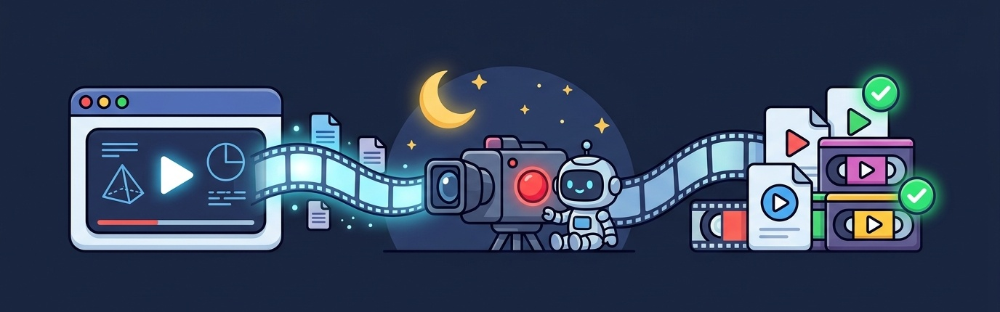

# Browser Video Recorder

**An agent skill that records videos playing in your browser to MP4, so you can watch them
offline.** Lectures, course replays, webinars, meeting recordings. Give your AI agent one course
link: it finds the videos, downloads what the site offers, and records the rest overnight with OBS
Studio. It follows the open [Agent Skills](https://agentskills.io/) standard, so it works with any
agent that supports skills (for example Claude Code, OpenAI Codex, Gemini CLI, GitHub Copilot,
Cursor), and with any agent that can read a file and run commands.

## Who is it for?

Students whose course site has no download button, anyone catching up on missed lectures or
webinars offline, and people archiving training videos before access expires. If a site offers a
download, the skill uses it and records only what can't be downloaded.

## Quick start

1. **Install the skill** (once). With any agent, paste this:

   > *"Install the agent skill from https://github.com/Natboa/browser-video-recorder (the folder
   > `skills/browser-video-recorder`) into your skills folder, then run its setup check."*

   An agent without skills support can simply be told to clone the repo and follow
   `skills/browser-video-recorder/SKILL.md`. Claude Code also has a one-step plugin install (below).
2. **Start a new session** of your agent (a running one may not see a new skill).
3. **Ask** in plain words: *"Record these 6 lessons so I can watch them offline:
   https://your-course-site.example/course"*
4. **Go to sleep:** leave the laptop **plugged in with the lid open**. You can **mute it** for a
   quiet night; the recording still gets full sound.

The agent checks your setup first and asks before installing anything.

## Install

"Installing" just makes the skill's folder (`SKILL.md` plus scripts) available to your agent. Nothing
runs until you ask for videos.

- **Any agent with skills support:** copy the folder
  [`skills/browser-video-recorder`](skills/browser-video-recorder) into that agent's skills folder
  (see its documentation for where), or ask the agent to do it as in the quick start.
- **Any other agent:** `git clone https://github.com/Natboa/browser-video-recorder`, open the agent in
  that folder and tell it to follow `skills/browser-video-recorder/SKILL.md`.
- **Claude Code (optional one-step plugin):** `/plugin marketplace add Natboa/browser-video-recorder`
  then `/plugin install browser-video-recorder@browser-video-recorder`. This also adds a
  `/record-videos` command. Update later with `/plugin marketplace update browser-video-recorder`.
  (Or copy the skill folder into `%USERPROFILE%\.claude\skills\`.)

## Requirements

Windows 10/11, [OBS Studio](https://obsproject.com/) 28+, Python 3.10+, ffmpeg, and Edge or Chrome.
The agent checks all of it for you. Details and install commands: [docs/requirements.md](docs/requirements.md).

## What you get

- **Unattended batch recording:** videos are recorded one after another, overnight if you like.
- **One link is enough:** a course, playlist or series page is listed for you to confirm.
- **Clean files:** only the video window and its sound, no notifications, no black bars.
- **No wasted nights:** a test clip must pass first, and every file is checked afterwards.
- **Optional silence trimming:** long quiet stretches (exercises, breaks) cut out of copies.

## Boundaries

It records what you are already allowed to watch. Official downloads come first, and every site is tried. It stops only if the site
really blocks recording (DRM black frames, or playback cut off). DRM and bot protection are never
bypassed, and recordings are for your own offline use. [More](docs/boundaries.md).

## More

[Tested sites](docs/compatibility.md) · [How it works](docs/how-it-works.md) ·
[Trimming silences](docs/trimming-silences.md) · [FAQ](docs/faq.md) ·
[Troubleshooting](skills/browser-video-recorder/references/troubleshooting.md) · [Changelog](CHANGELOG.md)

## License

[MIT](LICENSE)
